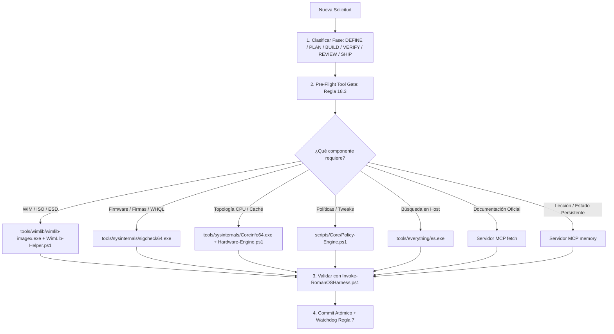

# GOVERNANCE-MATRIX.md — Matriz Maestra de Gobernanza Operativa (Agentic OS)
# romanOS / OptimizedISO — Ecosistema de Ingeniería y Desarrollo para Windows

> **CONTRATO OPERATIVO VINCULANTE (Regla 17 y Regla 18):**  
> Este documento codifica el **Marco Operativo de Gobernanza Total** del agente. Ninguna acción en el repositorio puede ejecutarse al margen de esta matriz.  
> Cada tarea DEBE alinearse obligatoriamente con la fase correspondiente de su ciclo de vida, activando los servidores MCP, las skills del repositorio, las herramientas locales herméticas y las compuertas de calidad de `CONSTRAINTS.md`.

---

## 1. El Ciclo de Vida Operativo de 6 Fases (Estándar agent-skills / romanOS)

```
  ┌──────────────┐     ┌──────────────┐     ┌──────────────┐     ┌──────────────┐     ┌──────────────┐     ┌──────────────┐
  │  1. DEFINE   │ ──▶ │   2. PLAN    │ ──▶ │   3. BUILD   │ ──▶ │  4. VERIFY   │ ──▶ │  5. REVIEW   │ ──▶ │   6. SHIP    │
  │(Requisitos & │     │(Desglose Git │     │(Implementar  │     │ (TDD & Proof │     │ (Auditoría   │     │ (Commit &    │
  │ Fuente Real) │     │  Map-Reduce) │     │ Soberano)    │     │  en Arnés)   │     │ Anti-Sesgo)  │     │ Memoria MCP) │
  └──────────────┘     └──────────────┘     └──────────────┘     └──────────────┘     └──────────────┘     └──────────────┘
```

---

## 2. Catálogo Operacional Fase por Fase

### FASE 1: DEFINE (Especificación e Interrogación de Requisitos)
* **Objetivo:** Definir qué construir con precisión matemática y respaldo de documentación oficial. Prohibido codificar basándose en suposiciones o mitos.
* **Principio Rector:** *Spec before code.* (Doubt-Driven Development - D3).

| Dimensión | Asignación Obligatoria | Protocolo de Ejecución |
| :--- | :--- | :--- |
| **Servidores MCP** | • **`fetch`** (`fetch_markdown`, `read_url_content`)<br>• **`memory`** (`search_nodes`, `read_graph`) | • Extraer especificaciones oficiales de Microsoft Learn, AMD Developer, Intel WDDM.<br>• Consultar el grafo de conocimiento persistente para recuperar decisiones técnicas y restricciones de sesiones previas. |
| **Skills Asignadas** | • `interview-me` / `ask_question`<br>• `project-audit`<br>• `kb-catalog-researcher` | • Interrogar al usuario si hay ambigüedad estética o de preferencias de UI/UX.<br>• Auditar el estado actual del generador de ISO antes de proponer cambios.<br>• Investigar KBs oficiales en Microsoft Update Catalog si involucra servicing. |
| **Herramientas Locales** | • `tools/everything/es.exe` | • Mapear existencia de archivos y dependencias sin saturar el contexto. |
| **Gobernanza `AGENTS.md`** | • **Regla 2 (Cero Suposiciones)**<br>• **Regla 11 (Autonomía de Ingeniero)**<br>• **Regla 17.2 (Ciclo D3)**<br>• **Regla 19 (Inquisición Cero-Confianza)** | • Prohibido afirmar que un tweak de registro o flag funciona sin respaldo oficial.<br>• El agente asume la responsabilidad técnica de arquitectura, hardware y registro.<br>• Formular: *Claim $\rightarrow$ Doubt $\rightarrow$ Reconcile $\rightarrow$ Stop*.<br>• Someter toda afirmación al Tribunal de Fuentes Oficiales antes de codificar o probar. |
| **Puertas `CONSTRAINTS.md`** | Dimensión F / L1 / L2 | Establecer que el cambio no sea un placebo ni use comandos deprecados (`wmic`). |

---

### FASE 2: PLAN (Desglose Atómico y Persistencia Git)
* **Objetivo:** Fragmentar la solución en tareas atómicas y persistirlas formalmente en Git como única Fuente de Verdad.
* **Principio Rector:** *Small, atomic tasks & Git as SSOT.* (Patrón Map-Reduce).

| Dimensión | Asignación Obligatoria | Protocolo de Ejecución |
| :--- | :--- | :--- |
| **Servidores MCP** | • **`memory`** (`create_entities`, `create_relations`) | • Registrar la épica o hito en el grafo persistente con sus dependencias. |
| **Skills Asignadas** | • `planning-and-task-breakdown`<br>• `ecosystem-sync` | • Fragmentar el trabajo en tareas atómicas acotadas de 3 a 5 elementos (Map-Reduce).<br>• Ejecutar análisis de impacto en cascada sobre los scripts consumidores (SSOT). |
| **Artefacto Git Obligatorio** | • `docs/plans/PLAN-NNNN-YYYYMMDD-<slug>.md`<br>• `docs/plans/README.md` | • Crear el plan formal en markdown con metadatos, fases, y estado `EN PROGRESO`.<br>• Registrar inmediatamente la entrada correlativa en el índice maestro de planes. |
| **Gobernanza `AGENTS.md`** | • **Regla 0 (Git SSOT Paso Cero)**<br>• **Regla 5 (Trazabilidad de Planes)**<br>• **Regla 15 (Map-Reduce Anti-Amnesia)** | • Ejecutar `git status`, `git log -n 5 --oneline` y `git diff` antes de tocar archivos.<br>• Prohibido dejar planes solo en la memoria de chat efímera.<br>• Procesamiento en lotes de 3-5 items para evitar *lost-in-the-middle*. |

---

### FASE 3: BUILD (Implementación Incremental y Soberanía Tecnológica)
* **Objetivo:** Escribir código limpio, modular y determinista utilizando exclusivamente los recursos canónicos del repositorio.
* **Principio Rector:** *Build one slice at a time with strict tool sovereignty.*

| Dimensión | Asignación Obligatoria | Protocolo de Ejecución |
| :--- | :--- | :--- |
| **Paso Cero de Herramientas** | **Pre-Flight Tool Gate (Regla 18.3)** | Declarar explícitamente en el razonamiento la tupla:<br>1. *Skill Declarada*<br>2. *Componente Asignado (`tools/` o `scripts/Core/`)*<br>3. *Verificación de Aislamiento* |
| **Herramientas Locales Herméticas** | • **WIM/ESD/ISO:** `tools\wimlib\wimlib-imagex.exe` y `scripts\Core\WimLib-Helper.ps1`<br>• **Firmas/WHQL:** `tools\sysinternals\sigcheck64.exe` y `Sysinternals-Helper.ps1`<br>• **CPU/Caché:** `tools\sysinternals\Coreinfo64.exe` y `Hardware-Engine.ps1`<br>• **Políticas:** `scripts\Core\Policy-Engine.ps1` (SSOT canónico)<br>• **Hardware:** `scripts\Core\Hardware-Engine.ps1` (Topología dinámica) | • **PROHIBICIÓN TAXATIVA (Regla 18.1):** 0 llamadas a `7z.exe`, `C:\Program Files`, o `dism /Mount-Wim` para lectura.<br>• Toda manipulación WIM se ejecuta en modo Zero-Mount multihilo.<br>• Toda directiva de optimización debe registrarse canónicamente en `Policy-Engine.ps1`. Prohibidas directivas huérfanas en consumidores. |
| **Skills Asignadas** | • `powershell-windows`<br>• `unattended-deployment`<br>• `iso-security-hardening`<br>• `windows-updates-servicing` | • Cumplir estrictamente codificación **UTF-8 con BOM (`0xEF, 0xBB, 0xBF`)** en `.ps1` y **No-BOM** en `.cmd`.<br>• Validar esquemas XML contra `urn:schemas-microsoft-com:unattend`.<br>• Preservar compatibilidad Ring-0 con anti-cheats (Vanguard, EAC, BattlEye). |
| **Gobernanza `AGENTS.md`** | • **Regla 4 (Codificación y PS 5.1)**<br>• **Regla 9 (SSOT Policy-Engine)**<br>• **Regla 14 (Salvaguarda Host y Multi-Hardware)**<br>• **Regla 18 (Soberanía de Herramientas)** | • Prohibido asumir compatibilidad por PS 7; probar en Windows PowerShell 5.1.<br>• Cero comandos destructivos de disco en el host (`Format-Volume`, `Clear-Disk`).<br>• Arquitectura en 3 Capas: Invariantes Universales, Topología Dinámica y Fallback Seguro. |

---

### FASE 4: VERIFY (Pruebas Conducidas por Restricciones - TDD / Proof)
* **Objetivo:** Probar empíricamente que la implementación funciona sin regresiones colaterales.
* **Principio Rector:** *Tests are proof.* (Red $\rightarrow$ Green $\rightarrow$ Refactor).

| Dimensión | Asignación Obligatoria | Protocolo de Ejecución |
| :--- | :--- | :--- |
| **Compuertas Mecánicas de Validación** | • **L1 (`check:fast`):** `powershell.exe -File scripts/Testing/Invoke-RomanOSHarness.ps1 -Fast`<br>• **L2 (`check:task`):** `powershell.exe -File scripts/Testing/Invoke-RomanOSHarness.ps1` | • Ejecutar L1 de inmediato (< 3s) tras modificar cualquier archivo de código o script.<br>• Ejecutar L2 (< 12s) para validar SSOT de políticas, esquemas XML y matriz de mocks multi-hardware. |
| **Herramientas de Mocks en Memoria** | • `scripts/Testing/Test-HardwareTopologyMocks.ps1` | • Certificar compatibilidad en memoria simulando: Intel P/E Cores, AMD X3D Dual-CCD, APU UMA y discos mecánicos SATA. |
| **Skills Asignadas** | • `test-driven-development` (TDD)<br>• `debug-strategy` | • Regla "Beyoncé": *If you liked it, put a test on it* (Regla 17.3).<br>• Si una prueba falla, aplicar el ciclo de 5 pasos (*Reproduce $\rightarrow$ Localize $\rightarrow$ Reduce $\rightarrow$ Fix $\rightarrow$ Guard*). |
| **Gobernanza `AGENTS.md`** | • **Regla 13 (CWE-390 / Fail-Visible)**<br>• **Regla 17.4 (Stop-the-Line)** | • **0 bloques `catch { }` vacíos.** Toda captura debe emitir advertencia o log detallado.<br>• Ante cualquier fallo en el arnés (`ExitCode 1`), **se detiene la línea de producción**; prohibido avanzar hasta resolver la causa raíz. |

---

### FASE 5: REVIEW (Auditoría Holística y Anti-Racionalización)
* **Objetivo:** Inspeccionar transversalmente el impacto de los cambios, erradicando parches cosméticos y sesgos de confirmación.
* **Principio Rector:** *Improve code health & Reject excuses.* (Whole-Repository Scope).

| Dimensión | Asignación Obligatoria | Protocolo de Ejecución |
| :--- | :--- | :--- |
| **Skills Asignadas** | • `code-review` / `code-review-and-quality`<br>• `holistic-audit`<br>• `log-forensics` | • Auditoría en 5 ejes: Sintaxis AST, UTF-8 BOM, CWE-390, STA threading en GUIs, y tipado estricto.<br>• Alcance repo-wide: extender correcciones al 100% de los scripts del proyecto.<br>• Lectura estructural de logs con grep físico; prohibido el sesgo de confirmación (Regla 12). |
| **Gobernanza `AGENTS.md`** | • **Regla 0 (Revisión de `git diff`)**<br>• **Regla 16 (Determinismo)**<br>• **Regla 17.1 (Matriz Anti-Racionalización)**<br>• **Regla 19 (Tribunal de Fuentes Oficiales)** | • Auditar `git diff` línea por línea antes de preparar el commit.<br>• Prohibido declarar "completado" sin artefacto verificado en disco (bytes > 0, hash SHA-256).<br>• Aplicar la tabla de rechazo incondicional contra excusas típicas del agente.<br>• Verificar que ninguna clave o tweak introducido sea un placebo o comando deprecado. |
| **Herramientas Locales** | • `tools/sysinternals/sigcheck64.exe` | • Certificar firmas Authenticode y WHQL de controladores inyectados. |

---

### FASE 6: SHIP (Trazabilidad, Persistencia en Grafo y Commit Atómico)
* **Objetivo:** Sincronizar el repositorio, registrar lecciones en la memoria persistente y cerrar formalmente el ciclo.
* **Principio Rector:** *Faster is safer when verified.* (Docs-as-Code).

| Dimensión | Asignación Obligatoria | Protocolo de Ejecución |
| :--- | :--- | :--- |
| **Servidores MCP** | • **`memory`** (`add_observations`, `create_entities`)<br>• **`github`** (`push_files`, `create_pull_request`) | • Registrar las observaciones técnicas y lecciones aprendidas en el grafo persistente.<br>• Sincronizar ramas y commits limpios en el remoto si aplica. |
| **Supervisión Automática** | • **Regla 7 (Watchdog de Tareas / `schedule`)** | • Antes de ejecutar `git commit` con pre-commit hooks (~75s), emitir aviso visible y programar un temporizador de supervisión `schedule`. |
| **Skills Asignadas** | • `git-workflow`<br>• `memory-protocol`<br>• `ecosystem-sync` | • Preparar commits atómicos y limpios exclusivamente de código fuente y documentación.<br>• Actualizar documentación en cascada (`README.md`, guías, planes) tratando docs como código. |
| **Gobernanza `AGENTS.md`** | • **Regla 6 (Cero Binarios Pesados en Git)**<br>• **Regla 10 (Mantenimiento en Cascada)** | • Prohibido commitear archivos `.iso`, `.wim`, `.esd`, `.vhdx`, o `.msu`.<br>• Actualizar el estado del plan en `docs/plans/README.md` a `COMPLETADO`. |

---

## 3. Matriz Anti-Racionalización Operativa (Rechazo de Atajos)

| Exculpa / Justificación Típica del Agente | Acción Mecánica Obligatoria |
| :--- | :--- |
| *"Usé 7-Zip porque era más rápido de escribir."* | **RECHAZADO (Regla 18 / Dimensión E).** Arnés falla en Tier 1.5. Obligatorio refactorizar consumiendo `wimlib-imagex` y `WimLib-Helper.ps1`. |
| *"La prueba pasó en memoria con un mock, así que la ISO está lista."* | **RECHAZADO (Regla 16).** Sin archivo ISO físico en disco (> 0 bytes) inspeccionado, el estado es `PENDIENTE DE COMPILACIÓN FÍSICA`. |
| *"Capturé el error con catch {} para que el script no se interrumpa."* | **RECHAZADO (Regla 13 / CWE-390).** Arnés falla en Tier 1.4. Todo catch debe emitir advertencia o telemetría visible. |
| *"Solo toqué un archivo, no hace falta correr el arnés completo."* | **RECHAZADO (CONSTRAINTS.md).** Obligatorio ejecutar `check:fast` tras cualquier edición y `check:task` al cerrar tarea. |
| *"El log es muy largo, asumo que todo salió bien porque vi líneas verdes al final."* | **RECHAZADO (Regla 12).** Prohibido sesgo de confirmación. Obligatorio `grep_search` buscando `FAIL`, `ERROR` o `Exception` en el archivo físico de log. |
| *"El script superó la prueba con ExitCode 0, así que está verificado y correcto."* | **RECHAZADO (Regla 19 / Dimensión F).** Falacia de validación circular. Una prueba no es válida si convalida un placebo, comando deprecado (`wmic`) o tweak dañino. Obligatorio contrastar primero con especificación oficial. |

---

## 4. Enrutamiento Rápido de Tareas por Dominio


