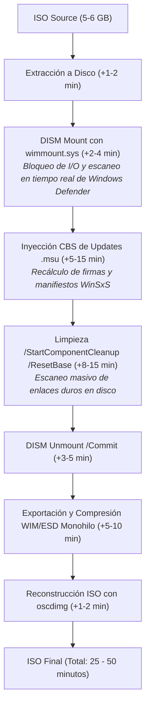
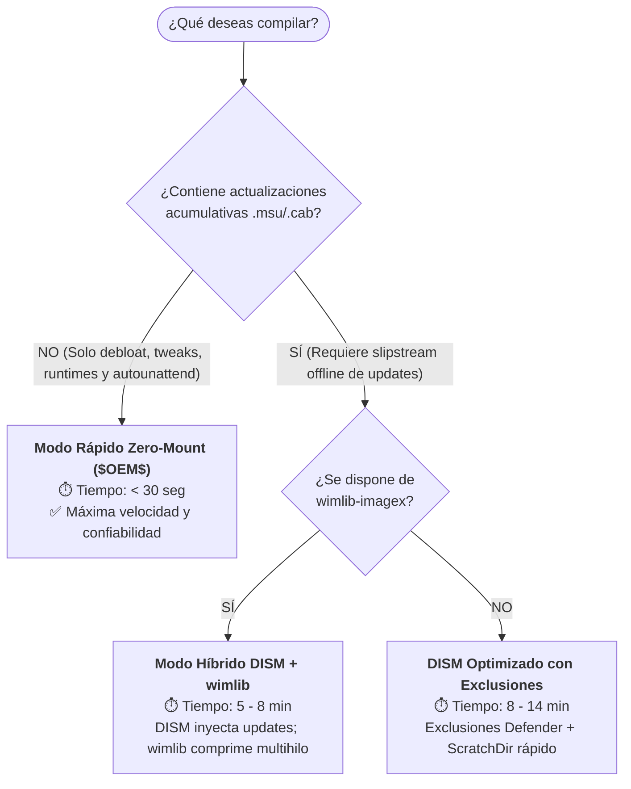

# 📊 Comparativa de Métodos y Rendimiento para Creación de ISOs de Windows

Este documento detalla el análisis técnico de los diferentes métodos, herramientas oficiales de Microsoft y soluciones de alto rendimiento de la comunidad para la personalización, optimización y generación de medios de instalación ISO de Windows 11.

---

## 1. Diagnóstico de Rendimiento: ¿Por qué el Pipeline Tradicional es Lento?

En el enfoque convencional de personalización con DISM ([`New-OptimizedWindowsISO-v2.ps1`](../scripts/New-OptimizedWindowsISO-v2.ps1)), el tiempo de ejecución típico oscila entre **20 y 45 minutos**. Los principales cuellos de botella identificados son:



### Factores Críticos del Cuello de Botella
1. **Controlador de Filtro de Sistema de Archivos (`wimmount.sys`)**:
   Montar una imagen WIM requiere proyectar cientos de miles de enlaces duros (*hard links*) y descriptores de seguridad NTFS. Windows Defender analiza cada archivo abierto, degradando el I/O drásticamente.
2. **Motor CBS (Component-Based Servicing)**:
   Inyectar paquetes `.msu` y ejecutar `/ResetBase` fuerza a Windows a consolidar el almacén WinSxS de manera secuencial y transaccional.
3. **Compresión Monohilo en `WIMGAPI.dll`**:
   La biblioteca oficial de Microsoft (`wimgapi.dll`) no aprovecha al máximo los procesadores multinúcleo modernos durante la fase de compresión LZX/LZMS (Solid ESD).

---

## 2. Tabla Comparativa de Rendimiento y Capacidades

| Método / Herramienta | Tiempo Típico de Build | ¿Requiere Montar WIM? | Soporte Updates `.msu` Offline | Uso de CPU Multihilo | Complejidad de Implementación | Ecosistema / Soporte |
| :--- | :---: | :---: | :---: | :---: | :---: | :--- |
| **1. Enfoque Zero-Mount ($OEM$ Overlay + autounattend.xml)** | **< 30 seg** | **NO** | No *(Se aplican en OOBE/Primer Boot)* | N/A (Poco I/O) | Sencilla | **Oficial Microsoft** |
| **2. wimlib-imagex (Direct Archive Update + SIMD Export)** | **1 - 3 min** | **NO** | No *(Solo archivos, registro y AppX)* | **100% (Todos los núcleos)** | Media (Portable CLI) | **Estándar Comunidad (Rufus, UUPDump)** |
| **3. Windows Configuration Designer (`.ppkg` / `icd.exe`)** | **~ 1 min** | **NO** | No *(Aprovisionamiento en OOBE)* | Media | Media | **Oficial Microsoft (ADK)** |
| **4. DISM Optimizado (RAMDisk + Exclusión Defender + Fast Compress)** | **6 - 12 min** | Sí | **SÍ (CBS Completo)** | Parcial | Media | **Oficial Microsoft** |
| **5. DISM Tradicional (Mount + ResetBase + Solid Export)** | **20 - 45 min** | Sí | **SÍ (CBS Completo)** | Baja | Alta | **Oficial Microsoft** |
| **6. Full Flash Update (FFU por sectores)** | **2 - 3 min** *(Despliegue)* | Sí *(Captura previa)* | SÍ | Alta | Muy Alta (Específico de hardware) | **Oficial Microsoft (OEM)** |

---

## 3. Análisis Detallado de Métodos

### Método 1: Enfoque "Zero-Mount / $OEM$ Overlay" (Oficial Microsoft)
* **Principio:** La imagen `install.wim` de origen **nunca se monta ni se descomprime**. Se mantiene 100% intacta.
* **Mecanismo:**
  1. Se extrae o se prepara la estructura de la ISO.
  2. Se colocan los scripts de optimización ([`Win11-Debloat-v3-Adaptive.ps1`](../scripts/Win11-Debloat-v3-Adaptive.ps1), [`Invoke-WindowsSecurityHardening.ps1`](../scripts/Invoke-WindowsSecurityHardening.ps1), runtimes, tweaks) en `sources\$OEM$\$1\Windows\Setup\Scripts\`.
  3. Se inyecta [`autounattend.xml`](../.agents/skills/unattended-deployment/scripts/Test-UnattendXml.ps1) en la raíz de la ISO.
  4. Se compila la ISO con `oscdimg.exe`.
* **Resultado:** La ISO se genera en **15 a 30 segundos**. Cuando el usuario instala Windows, el instalador copia automáticamente los archivos de `$OEM$` al disco y `autounattend.xml` ejecuta los scripts en la fase `specialize` o `FirstLogonCommands`.

---

### Método 2: `wimlib-imagex` (Modificación Directa sin Montaje)
* **Principio:** Modifica directamente la tabla de archivos y el archivo binario `.wim` sin interactuar con los controladores del kernel de Windows ni crear carpetas montadas.
* **Mecanismo:**
  ```powershell
  # Inyección de directorio completa en 2 segundos:
  & wimlib-imagex update "install.wim" 1 --command="add C:\Optimizaciones \Windows\Setup\Scripts"
  
  # Exportación y compresión sólida ultra-rápida (multihilo):
  & wimlib-imagex export "install.wim" 1 "install.esd" --solid --threads=16
  ```
* **Ventajas:**
  * No produce bloqueos de carpetas ni archivos huérfanos.
  * Compresión LZX y LZMS acelerada con instrucciones SIMD (`libdeflate`).
  * 100% portable: no requiere instalar el Windows ADK completo.
* **Limitación:** No puede procesar actualizaciones `.msu` dependientes de Component-Based Servicing (CBS).

---

### Método 3: Paquetes de Aprovisionamiento (`.ppkg` vía `icd.exe`)
* **Principio:** Estándar empresarial moderno de Microsoft. Permite compilar configuraciones, políticas de grupo, certificados, cuentas locales y scripts en un paquete `.ppkg`.
* **Mecanismo:** El archivo `.ppkg` se coloca en el medio de instalación o en `$OEM$\$1\Recovery\Customizations\` y Windows lo aplica durante OOBE.

---

### Método 4: Pipeline DISM Acelerado (Para Integración Obligatoria de `.msu`)
Cuando es estrictamente necesario inyectar parches acumulativos offline (`Get-WindowsUpdates.ps1`), DISM puede acelerarse significativamente mediante:
1. **Exclusión temporal de Windows Defender:**
   ```powershell
   Add-MpPreference -ExclusionPath "$MountDir", "$ScratchDir"
   ```
2. **Scratch Directory en RAMDisk o NVMe:**
   ```powershell
   dism.exe /Image:"$MountDir" /ScratchDir:"R:\Scratch" /Add-Package ...
   ```
3. **Omitir `/ResetBase` en builds de desarrollo:** El flag `-SkipComponentCleanup` ahorra entre 10 y 20 minutos de espera.
4. **Compresión Rápida + Post-Export:** Guardar con `/Compress:fast` en DISM y delegar la compresión final sólida a `wimlib-imagex`.

---

## 4. Matriz de Decisión Recomendada



---

## 5. Conclusión y Hoja de Ruta

Para maximizar la productividad y eficiencia en el repositorio:
1. El **Modo Rápido Zero-Mount (`-FastBuild`)** debe ser el modo por defecto para pruebas e iteraciones diarias, reduciendo el tiempo de espera de 30 minutos a 30 segundos.
2. El **Modo Híbrido con `wimlib-imagex`** debe implementarse como acelerador universal de compresión y manipulación WIM.
3. El **Motor DISM** debe reservarse exclusivamente para cuando existan archivos `.msu` en la carpeta `Updates/`.
