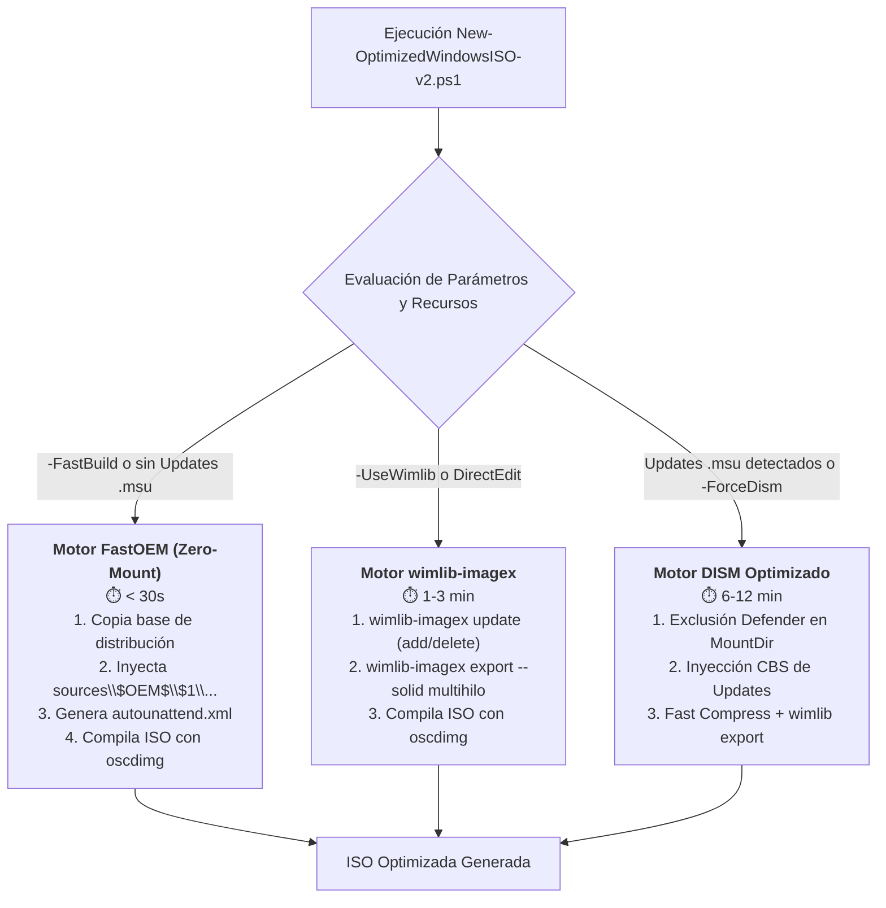

# 📋 PLAN-0011: Modo Rápido de Compilación (Zero-Mount / $OEM$ Overlay) e Integración de wimlib-imagex

| Metadato | Valor |
|---|---|
| **Número** | 0011 |
| **Fecha** | 2026-08-30 |
| **Título** | Modo Rápido de Compilación (Zero-Mount / $OEM$ Overlay) e Integración de wimlib-imagex |
| **Estado** | COMPLETADO |
| **Autor** | Antigravity AI |
| **Rama** | `feature/offline-ui-tweaks` (o rama dedicada `feature/fast-build-wimlib`) |

---

> [!NOTE]
> **Actualización Histórica (PLAN-0018 - 2026-09-01):**
> Tras la evaluación empírica en producción, los Motores 1 (FastOEM Zero-Mount) y 2 (wimlib Direct) fueron deprecados y removidos en [PLAN-0018](PLAN-0018-20260901-refactor-consolidate-dism-servicing-engine.md) debido a que no realizan el debloat offline profundo en `install.wim` (AppX provisionados, registro offline, optimizaciones de hardware PLAN-0013 a PLAN-0017). Se consolidó el **Motor 3 (DISM Servicing Optimizado)** reteniendo las mejoras de rendimiento de exclusiones de Defender (`Set-BuildDefenderExclusions` y `-DisableDefenderExclusion`).

---

## 1. Resumen Ejecutivo

El pipeline actual de construcción de ISOs en [`New-OptimizedWindowsISO-v2.ps1`](../../scripts/New-OptimizedWindowsISO-v2.ps1) depende exclusivamente del montaje completo de imágenes WIM mediante DISM (`wimmount.sys`), lo que produce tiempos de ejecución de **20 a 45 minutos** debido al recálculo de manifiestos WinSxS, escaneo en tiempo real de Windows Defender y recompresión monohilo en `WIMGAPI.dll`.

Este plan implementa una **arquitectura de motores de compilación escalonada** (*Tiered Build Engines*):
1. **Motor 1 (FastOEM / Zero-Mount)**: Construcción ultrarrápida en **< 30 segundos** sin montar el WIM, inyectando scripts y runtimes en `sources\$OEM$\$1\` y orquestando la optimización mediante [`autounattend.xml`](../../.agents/skills/unattended-deployment/scripts/Test-UnattendXml.ps1).
2. **Motor 2 (wimlib-imagex Direct Engine)**: Manipulación directa del archivo `.wim` sin montaje en sistema de archivos y compresión multihilo SIMD en **1 a 3 minutos**.
3. **Motor 3 (DISM Servicing Optimizado)**: Motor CBS completo para integración de actualizaciones acumulativas (`.msu`), con exclusiones automáticas de Windows Defender y aceleración de I/O.

---

## 2. Objetivos y Criterios de Éxito

1. **Reducción de Tiempo de Compilación**:
   * Modo `-FastBuild` genera una ISO arrancable completa en **menos de 60 segundos** en discos SSD/NVMe.
2. **Cero Regresiones Funcionales**:
   * Todas las optimizaciones (debloat, hardening de seguridad, runtimes VC++/DirectX, diagnóstico de red, bypasses TPM/NRO y autologon) se ejecutan con idéntica efectividad durante OOBE/Primer Inicio.
3. **Compatibilidad Estricta**:
   * Cumplimiento estricto de codificación UTF-8 con BOM (`UTF-8-BOM`) y compatibilidad con Windows PowerShell 5.1 (`powershell.exe`) y PowerShell 7+ (`pwsh`).
4. **Detección y Fallback Automático**:
   * Si el usuario proporciona actualizaciones `.msu` en `Updates/`, el orquestador conmuta automáticamente al motor DISM CBS o advierte de la necesidad de montaje.

---

## 3. Arquitectura Técnica y Cambios Propuestos

### Componente 1: Parámetros y CLI de `New-OptimizedWindowsISO-v2.ps1`
* **Nuevos Parámetros:**
  * `[ValidateSet("Auto", "FastOEM", "Wimlib", "DISM")][string]$BuildEngine = "Auto"`
  * `[switch]$FastBuild`: Alias directo para `-BuildEngine FastOEM`.
  * `[switch]$UseWimlib`: Habilita aceleración por `wimlib-imagex`.
  * `[switch]$DisableDefenderExclusion`: Permite omitir la regla temporal de Windows Defender si el entorno corporativo no lo autoriza.

### Componente 2: Motor FastOEM (Zero-Mount)
* Estructura generada en la ISO:
  * `\sources\$OEM$\$1\Windows\Setup\Scripts\`:
    * `Win11-Debloat-v3-Adaptive.ps1`
    * `Invoke-WindowsSecurityHardening.ps1`
    * `Win11-Network-Diagnostics-Optimizer.ps1`
    * `Get-EssentialRuntimes.ps1` (o instaladores predescargados en `\Runtimes`)
    * `SetupComplete.cmd` (ejecuta los scripts al finalizar la instalación)
  * `\autounattend.xml`:
    * Configura `FirstLogonCommands` y `SynchronousCommand` para ejecutar la secuencia de optimización desatendida.

### Componente 3: Módulo de Integración de `wimlib-imagex`
* Función `Get-WimlibExecutable`:
  * Busca `wimlib-imagex.exe` en `PATH`, en `tools/wimlib/` o descarga versión portable verificada por SHA-256 si se solicita `-AutoInstallDeps`.
* Función `Invoke-WimlibUpdate`:
  * Ejecuta `wimlib-imagex update` para inyectar carpetas sin montar.
* Función `Invoke-WimlibExport`:
  * Ejecuta compresión multihilo paralela con todos los núcleos (`--threads=0`).

### Componente 4: Optimizador de DISM (Defender + Scratch)
* Función `Set-BuildDefenderExclusion`:
  * Añade exclusión temporal en Windows Defender durante el montaje y la remueve en el bloque `finally`.

---

## 4. Plan de Pruebas y Validación

1. **Prueba de Sintaxis y Codificación**:
   * Ejecutar [`Test-ScriptAstAndBom.ps1`](../../.agents/skills/powershell-windows/scripts/Test-ScriptAstAndBom.ps1) para verificar UTF-8 BOM y compatibilidad en Windows PowerShell 5.1.
2. **Prueba en Frío de Motores**:
   * Test de `-FastBuild -WhatIf` y `-BuildEngine Wimlib -WhatIf`.
3. **Prueba de Creación de Medios**:
   * Compilación de prueba en modo FastOEM con medición de tiempo (Stopwatch).
4. **Verificación en Hyper-V**:
   * Despliegue de la ISO resultante con [`New-TestVM-HyperV.ps1`](../../scripts/New-TestVM-HyperV.ps1) para verificar que el debloat, runtimes y tweaks se aplican 100% en OOBE.

---

## 5. Registro de Trazabilidad y Commits

* **Commit 1**: `docs(plans): registrar PLAN-0011 y comparativa de rendimiento de metodos ISO`
* **Commit 2**: `feat(build): implementar motor FastOEM (Zero-Mount) y CLI -FastBuild`
* **Commit 3**: `feat(wimlib): integrar acelerador wimlib-imagex y export multihilo`
* **Commit 4**: `test(build): anadir validaciones y pruebas de rendimiento en Test-OptimizedISO-v2`
