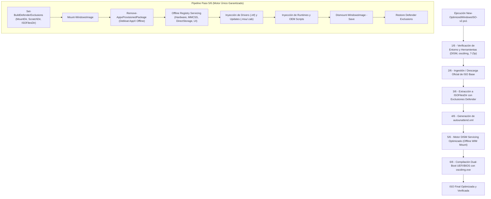

# 📋 PLAN-0018: Consolidación del Motor Único DISM Servicing Optimizado y Eliminación de Modos Ineficaces (FastOEM / Wimlib)

| Metadato | Valor |
|---|---|
| **Número** | 0018 |
| **Fecha** | 2026-09-01 |
| **Título** | Consolidación del Motor Único DISM Servicing Optimizado y Eliminación de Modos Ineficaces (FastOEM / Wimlib) |
| **Estado** | COMPLETADO |
| **Autor** | Antigravity AI |
| **Rama** | `feature/offline-ui-tweaks` |

---

## 1. Resumen Ejecutivo

El plan previo **PLAN-0011** introdujo tres modalidades de compilación:
1. **Opción 1 (FastOEM / Zero-Mount)**: Omitía el montaje offline de `install.wim` dejando la imagen 100% inflada y delegando el debloat a la fase OOBE/Primer Inicio.
2. **Opción 2 (wimlib-imagex Direct Engine)**: Manipulación directa de archivos WIM sin capacidad de servicio CBS, incapaz de ejecutar `Remove-AppxProvisionedPackage`, servicing de registro offline (`HKLM\temp_SOFTWARE`, `HKLM\temp_SYSTEM`) o integración de parches `.msu`.
3. **Opción 3 (DISM Servicing Optimizado)**: Motor CBS nativo con exclusiones automáticas de Windows Defender (`Set-BuildDefenderExclusions`), scratch directory dedicado y servicing offline completo.

La evaluación empírica y arquitectónica determinó que las Opciones 1 y 2 no cumplen con el objetivo fundamental de entregar una ISO verdaderamente optimizada y debloateada en su imagen base (`install.wim`), introduciendo código muerto, dependencias externas innecesarias y confusión en el usuario.

Este plan **PLAN-0018** refactoriza y consolida el pipeline de construcción en un **Motor Único DISM Servicing Optimizado**, reteniendo las mejoras de rendimiento de la Opción 3 (exclusiones de Windows Defender y aceleración de I/O) y eliminando por completo los parámetros, menús y funciones de los modos 1 y 2.

---

## 2. Objetivos y Criterios de Éxito

1. **Eliminación de Código Ineficaz y Dependencias Exógenas**:
   * Eliminar parámetros obsoletos: `-BuildEngine`, `-FastBuild`, `-UseWimlib`.
   * Eliminar funciones de detección y descarga externa de `wimlib-imagex` (`Test-WimlibInstalled`, `Get-WimlibExecutable`).
   * Eliminar la bifurcación condicional en el Paso 5/6 que saltaba el montaje y debloat de `install.wim`.
2. **Preservación de las Optimizaciones de Rendimiento de la Opción 3**:
   * Mantener `Set-BuildDefenderExclusions` (`-DisableDefenderExclusion`) para excluir temporalmente `$WimMountDir`, `$ScratchDir` y `$ISOFilesDir` durante el montaje/desmontaje.
   * Mantener el directorio `$ScratchDir` y la limpieza preventiva/reactiva de puntos de montaje huérfanos.
   * Garantizar el debloat offline profundo (AppX, Registro, Hardware Tweak Engine PLAN-0013 a PLAN-0017).
3. **Simplificación de la Experiencia de Usuario (UI/CLI)**:
   * Eliminar preguntas innecesarias en los menús interactivos (`Invoke-InteractiveConfiguration` e `Invoke-DeploymentChoices`).
   * Mostrar un flujo limpio y consistente orientado a calidad y rendimiento máximo.
4. **Calidad y Compatibilidad Estricta**:
   * Codificación obligatoria UTF-8 con BOM (`UTF-8-BOM`).
   * Validación en Windows PowerShell 5.1 (`powershell.exe`) y ejecución exitosa de la suite de pruebas `Test-OptimizedISO-v2.ps1` e `Invoke-TestSuite.ps1`.

---

## 3. Arquitectura y Cambios Propuestos

---

## 4. Plan de Pruebas y Validación

1. **Prueba de Codificación y AST**:
   * Verificar codificación UTF-8 con BOM en todos los scripts modificados.
2. **Prueba de Sintaxis en Windows PowerShell 5.1**:
   * Ejecutar en frío contra `powershell.exe -STA -NoProfile -ExecutionPolicy Bypass`.
3. **Prueba de Suite Unitaria (`Test-OptimizedISO-v2.ps1`)**:
   * Actualizar Fase 2N y verificar que todas las aserciones pasen (0 fallos).
4. **Ejecución del Orquestador General (`Invoke-TestSuite.ps1`)**:
   * Validación de toda la suite del repositorio.
