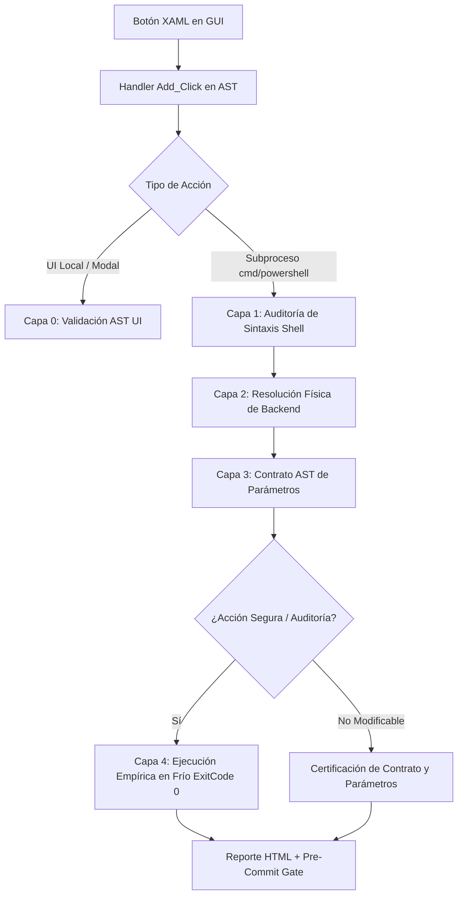

# PLAN-0145: Blindaje End-to-End (E2E) de Botones de GUI, Arnés de Integración de Subprocesos y Validación de Contratos de Backend

**Fecha:** 2026-09-29  
**Estado:** COMPLETADO  
**Área:** GUIs / Testing / Calidad de Software / Confiabilidad E2E  
**Repositorio:** romanOS / OptimizedISO  

---

## 1. Contexto y Justificación Técnica

Durante la operación de **romanOS Control Center**, se detectó que el botón *Auditar Invariantes romanOS* fallaba en tiempo de ejecución al ser presionado:
```
Falta la cadena en el terminador: '.
    + CategoryInfo          : ParserError: (:) [], ParentContainsErrorRecordException
    + FullyQualifiedErrorId : TerminatorExpectedAtEndOfString
[FALLO DE SUBPROCESO] Auditoria de Invariantes del Sistema concluyo con codigo de salida 1.
```

### Análisis Causa Raíz
1. **Punto Ciego de Invocación:** Los botones de la GUI despachan tareas asíncronas a través de `Start-ControlCenterTask`, la cual delega la ejecución a `cmd.exe /c powershell.exe -NonInteractive ...`. Si el comando contiene un salto de línea literal (`` `n ``) dentro de un bloque entre comillas, `cmd.exe` lo interpreta como dos comandos separados, truncando la instrucción y dejando comillas sin cerrar.
2. **Deficiencia del Arnés Previo (`Test-GuiIntegrityAndFunctionality.ps1`):**
   - El test anterior solo realizaba comprobación estática (existencia del botón XAML, presencia de `Add_Click` en AST y verificación de archivo `.ps1` en disco).
   - Solo 6 de 70+ botones tenían pruebas empíricas reales.
   - Ninguna prueba evaluaba el escape y sintaxis de la cadena construida por los botones al pasar por `cmd.exe`.
   - No se auditaba la correspondencia de parámetros (contrato) entre los argumentos enviados por el botón y el bloque `param(...)` del script destino.

---

## 2. Alcance y Universo de Auditoría

- **romanOS Control Center** ([`scripts/GUI/romanOS-ControlCenter.ps1`](file:///c:/OptimizedISO/scripts/GUI/romanOS-ControlCenter.ps1)): **91 botones**.
- **romanOS Studio** ([`scripts/GUI/romanOS-Studio.ps1`](file:///c:/OptimizedISO/scripts/GUI/romanOS-Studio.ps1)): **10 botones**.
- **Total:** **101 botones**.

---

## 3. Arquitectura del Arnés de Validación E2E (4 Capas)



### Capa 1: Sintaxis Shell y Blindaje Anti-Truncamiento
- Extraer cada orden construida para `Start-ControlCenterTask`.
- Verificar:
  - Cero saltos de línea sin escapar (`` `n `` o `` `r ``) dentro de cadenas de texto.
  - Cero comillas huérfanas o dobles comillas colapsadas.
  - Cero caracteres especiales de `cmd.exe` sin escape (`^`, `&`, `|`).
  - Validación AST directa contra `powershell.exe -Command`.

### Capa 2: Resolución Física de Backend
- Resolver la ruta absoluta de cada script invocado (`scripts/Modules/`, `scripts/Core/`, `scripts/Drivers/`, `scripts/Host-Tools/`, etc.).
- Garantizar existencia física comprobada en disco (`Test-Path`).

### Capa 3: Validación de Contrato de Parámetros (Parameter Binding)
- Analizar el bloque `param(...)` de cada script destino mediante AST.
- Extraer los argumentos pasados en el botón (ej. `-Action Remediate`, `-SkipElevation`, `-Mode Game`, `-Unattended`).
- Verificar que cada parámetro exista en el script destino y que los valores permitidos (`[ValidateSet(...)]`) sean respetados.

### Capa 4: Ejecución Empírica en Frío de Botones Seguros
- Ejecutar en un subproceso real (idéntico a la GUI) todos los botones clasificados como seguros (auditoría, diagnóstico, estado, conmutación de helpers y lectura).
- Certificar que finalizan con `ExitCode 0` y emiten telemetría válida.

---

## 4. Fases de Ejecución

- [x] **Fase 1:** Construcción del arnés de auditoría profunda `scripts/Testing/Test-GuiIntegrityAndFunctionality.ps1`.
- [x] **Fase 2:** Ejecución de la auditoría estática sobre los 101 botones (Capas 1, 2 y 3).
- [x] **Fase 3:** Corrección inmediata de cualquier anomalía de parámetros o sintaxis detectada.
- [x] **Fase 4:** Ejecución empírica en frío de todos los comandos seguros (Capa 4 - 22 subprocesos validados).
- [x] **Fase 5:** Actualización del reporte HTML `Auditoria-GUIs-romanOS.html` e integración en pre-commit hooks (Fase 15 en `Invoke-TestSuite.ps1`).
- [x] **Fase 6:** Validación final en Windows PowerShell 5.1 y commit atómico.

---

## 5. Resultados Cuantitativos de Certificación

| Métrica Forense | Objetivo | Resultado Obtenido | Estado |
| :--- | :---: | :---: | :---: |
| **Total Botones Auditados** | 101 | **101** (91 Control Center + 10 Studio) | PASS (100%) |
| **Cableados en AST (Wired)** | 101 | **101 / 101** | PASS (100%) |
| **Botones Muertos (Dead Buttons)** | 0 | **0** | PASS (0%) |
| **Sintaxis Shell Aprobada** | 101 | **101 / 101** (Cero saltos de línea / comillas rotas) | PASS (100%) |
| **Scripts Backend Resueltos** | 77 | **77 / 77** | PASS (100%) |
| **Contratos de Parámetros AST** | 77 | **77 / 77** | PASS (100%) |
| **Pruebas Empíricas en Frío** | 22 | **22 / 22** (`ExitCode 0` en subprocesos reales) | PASS (100%) |
| **Integración en Pre-Commit** | Activo | **Fase 15 en Invoke-TestSuite.ps1** | PASS |
